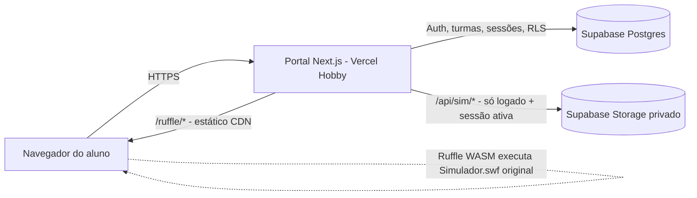

# Auditoria, requisitos e estratégia (Etapas 1–3)

> Resultado da análise técnica feita sobre a pasta original `simulador/`, **sem alterá-la** (somente leitura).

## 1. Inventário (Etapa 1)

| Item | Detalhe |
|---|---|
| Total | 52 arquivos, ≈ 4,25 MB |
| `Simulador.exe` | 4.456.496 bytes — SHA-256 `C3CCD48C696F3992033B0CFDB70F544A6E3B08D3E3A8465984D32CD6CD958C0A` |
| `Images/` | 40 `.jpg` (componentes de hardware e telas de erro), 2 `.gif`, 3 `.swf` (animações de defeito do monitor), 2 `.tmp`, `Thumbs.db` |
| `XML/` | `Portuguese.xml` (ISO-8859-1, textos/procedimentos/pontuação), `English.xml`, `LanguagesAvailable.xml`, `Portuguese___.xml` (arquivo estranho de um "Gerenciador BXP", não pertence ao simulador), `Portuguese.xml.LCK` |
| Datas dos arquivos | fevereiro–abril de 2005 |

Conteúdo: simulador oficial da Intel (ActionScript 2, 800×600, 70 fps) de **diagnóstico e manutenção de computadores** (procedimentos de hardware e software, pontuação inicial 10.000, penalidades e mensagens de desempenho).

## 2. Tecnologia e sistema operacional (Etapa 2)

| Verificação | Resultado |
|---|---|
| Formato do `.exe` | PE32 (Windows **32 bits**, x86) |
| Metadados do `.exe` | *Macromedia Flash Player 7.0 r14* (`SAFlashPlayer.exe`), © 1996-2003 Macromedia |
| Tecnologia real | **Projetor Flash standalone**: o executável é apenas o player Macromedia com o arquivo **`Simulador.swf`** (756.752 bytes, formato `CWS` v7, ActionScript 2) anexado ao final (assinatura `0xFA123456`) |
| Dependências | Portátil, sem instalador. O SWF carrega dinamicamente `XML/LanguagesAvailable.xml`, `XML/Portuguese.xml` (ou `English.xml`) e arquivos em `images/` |
| Particularidades descobertas nos testes | 1) O SWF pede `images/` em **minúsculas**, enquanto a pasta original é `Images/` (quebraria em Linux/Vercel sem normalização). 2) Os XMLs estão em `ISO-8859-1`; em Flash 7 Windows isso funcionava por `System.useCodepage`, mas no navegador precisa ser servido em `UTF-8` para preservar acentos (`ç`, `ã`, `ó`, `ê`). |

## 3. Licenciamento e distribuição

> [!WARNING]
> Não existe arquivo de licença na pasta `simulador/`. Antes de abrir o portal para turmas, confirme que a instituição possui autorização para disponibilizar o conteúdo do simulador (SWF, imagens, XMLs) para uso educacional.
>
> Precauções aplicadas neste projeto:
> - A pasta `simulador/` e os arquivos extraídos (`portal/sim-assets/`) estão no `.gitignore` e **não vão para o GitHub**.
> - Os arquivos do simulador ficam em um **bucket privado** do Supabase Storage e só são entregues pela rota autenticada `/api/sim/[...path]` para usuários logados, aprovados em uma turma e com sessão ativa.
> - Mantenha o repositório GitHub **privado**.

## 4. Estratégia escolhida: 100% gratuita (Vercel + Supabase + Ruffle)

Por decisão sua de **não contratar nenhum serviço pago**, adotamos a execução do **SWF original (extraído sem modificação do `Simulador.exe`)** no navegador via **Ruffle** (emulador Flash open-source em WebAssembly), integrado ao portal Next.js na Vercel e controle completo no Supabase:

| Critério | Solução escolhida (Vercel + Supabase + Ruffle) | Alternativa arquivada (`alternativa-wine-vps/`) |
|---|---|---|
| Custo mensal | **R\$ 0** (Vercel Hobby + Supabase Free + GitHub privado) | VPS KVM paga (4 vCPU / 8 GB) + domínio |
| Programa utilizado | `Simulador.swf` + `XML/` + `Images/` **originais**, rodando em Ruffle (WASM) | `Simulador.exe` original sob Wine + Apache Guacamole |
| Alunos simultâneos | Dezenas/centenas sem gargalo de servidor (roda na aba de cada aluno) | Limitado à RAM/CPU da VPS (~10–15 por 8 GB) |
| Isolamento entre alunos | Total (sandbox WebAssembly do navegador; impossível ver tela de outro aluno) | 1 container Docker por aluno |
| Instalação pelo aluno | Nenhuma (apenas navegador moderno) | Nenhuma |
| Validação prática | ✅ **Testado e comprovado no Chrome** (tela inicial, sintomas, ferramentas, pontuação e acentos em português) | ⏳ Exige servidor Linux KVM com Docker |

> Caso no futuro você queira migrar para execução remota do `Simulador.exe` em servidor com Wine + Apache Guacamole, toda a infraestrutura Docker/Caddy/orquestrador já construída foi preservada na pasta `alternativa-wine-vps/`.
